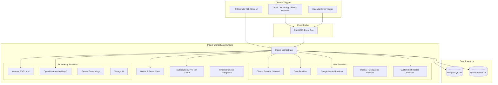
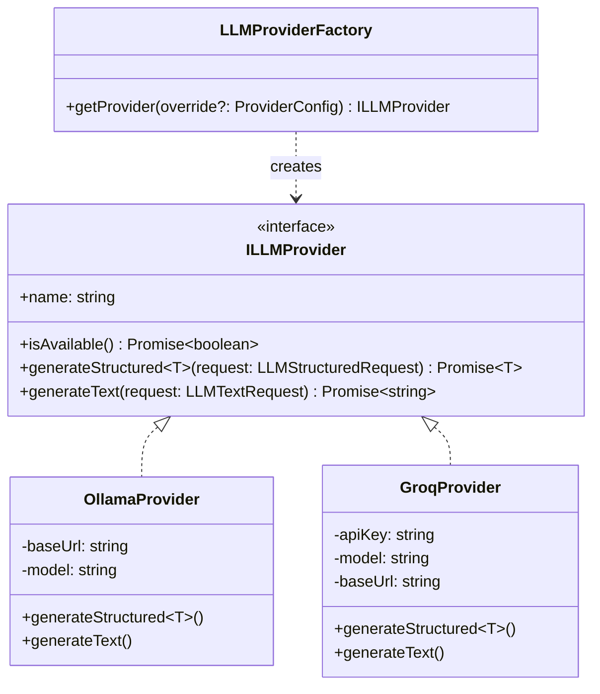
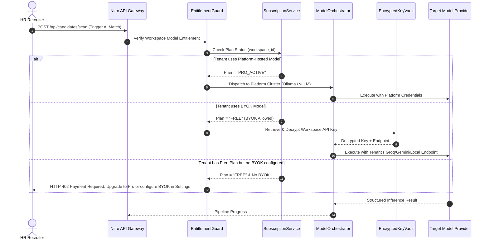
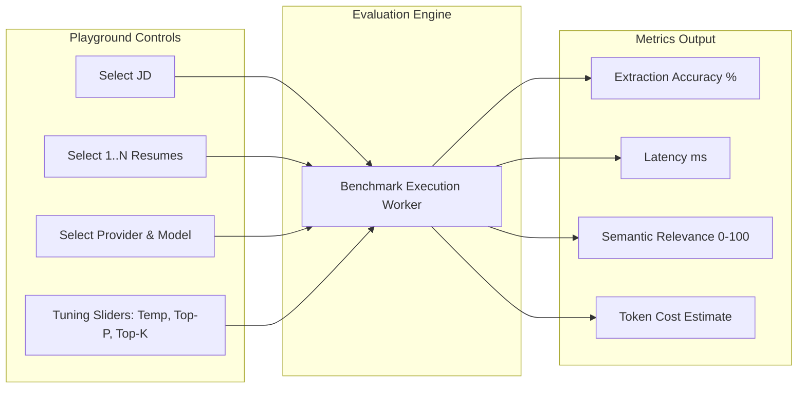
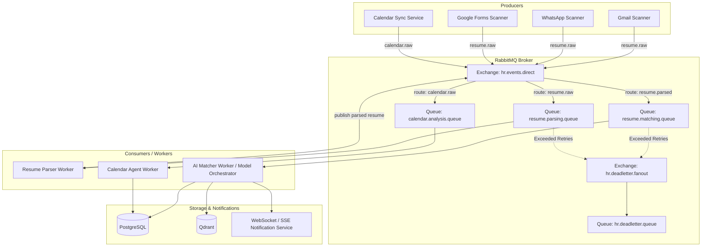

# Model Orchestration Engine — Low-Level Design (LLD)

**Status:** Architecture Blueprint & Implementation Specification  
**Version:** 1.0.0  
**Target Platform:** Nuxt 4 (Nitro Server) + PostgreSQL + Qdrant + RabbitMQ  

---

## Table of Contents
1. [Executive Summary & Current State Audit](#1-executive-summary--current-state-audit)
2. [Phase 1: Immediate MVP — Environment-Driven Provider Switching](#2-phase-1-immediate-mvp--environment-driven-provider-switching)
   - [2.1 Architecture & Strategy Pattern](#21-architecture--strategy-pattern)
   - [2.2 Configuration Specification](#22-configuration-specification)
   - [2.3 Core Interfaces & Types](#23-core-interfaces--types)
   - [2.4 Concrete Providers (Ollama & Groq)](#24-concrete-providers-ollama--groq)
   - [2.5 Provider Factory & Unified AI Client](#25-provider-factory--unified-ai-client)
   - [2.6 Migration of Existing AI Call-Sites](#26-migration-of-existing-ai-call-sites)
3. [Phase 2: Multi-Tenant BYOK, Hosted Pro Model & Role Separation](#3-phase-2-multi-tenant-byok-hosted-pro-model--role-separation)
   - [3.1 Platform-Hosted Model vs. BYOK (Bring Your Own Key)](#31-platform-hosted-model-vs-byok-bring-your-own-key)
   - [3.2 Role-Based Access Control: IT Admin vs. HR Recruiter](#32-role-based-access-control-it-admin-vs-hr-recruiter)
   - [3.3 Security & Secret Storage (AES-256-GCM)](#33-security--secret-storage-aes-256-gcm)
   - [3.4 Database Schema (PostgreSQL)](#34-database-schema-postgresql)
4. [Phase 3: Pluggable Embedding Architecture](#4-phase-3-pluggable-embedding-architecture)
   - [4.1 Embedding Provider Abstraction](#41-embedding-provider-abstraction)
   - [4.2 Provider Matrix (Local Xenova, OpenAI, Gemini, Voyage)](#42-provider-matrix-local-xenova-openai-gemini-voyage)
   - [4.3 Dynamic Qdrant Collection Management](#43-dynamic-qdrant-collection-management)
5. [Phase 4: Hyperparameter Tuning & Evaluation Playground](#5-phase-4-hyperparameter-tuning--evaluation-playground)
   - [5.1 Configurable Inference Parameters](#51-configurable-inference-parameters)
   - [5.2 Playground Workflow & Evaluation Matrix](#52-playground-workflow--evaluation-matrix)
   - [5.3 Metrics & Scoring Calibration](#53-metrics--scoring-calibration)
6. [Phase 5: Event-Driven Asynchronous Pipeline (RabbitMQ)](#6-phase-5-event-driven-asynchronous-pipeline-rabbitmq)
   - [6.1 Topology: Exchanges, Queues, Dead-Letter Queues](#61-topology-exchanges-queues-dead-letter-queues)
   - [6.2 Message Schemas & Event Lifecycle](#62-message-schemas--event-lifecycle)
   - [6.3 Rate Limiting, Circuit Breakers & Backoff Strategies](#63-rate-limiting-circuit-breakers--backoff-strategies)
7. [Implementation Roadmap](#7-implementation-roadmap)

---

## 1. Executive Summary & Current State Audit

### 1.1 Findings from Codebase Audit
1. **Groq Integration Status:** **NOT WORKING / INCOMPLETE**.
   - `GROQ_API_KEY` and `GROQ_MODEL` exist only in `.env`.
   - Grep search confirms **zero** lines in `server/` import, reference, or invoke Groq APIs.
2. **Current LLM Binding:** Hardcoded to Ollama.
   - `server/utils/ai.ts` directly calls `POST ${OLLAMA_URL}/api/generate` with hardcoded schema assumptions.
   - `server/utils/calendarAgent.ts` duplicates this logic with identical hardcoded calls.
3. **Current Embedding Binding:** Hardcoded to local `@xenova/transformers` (`Xenova/bge-small-en-v1.5`, 384 dimensions) in `server/utils/vectorMatch.ts`.
4. **Execution Model:** Fully synchronous inside Nitro HTTP request cycles (`scan-mail.post.ts`, `scan-forms.post.ts`, `sync-calendar.post.ts`), causing gateway timeouts and memory pressure.

### 1.2 Target Vision
A modular, vendor-agnostic **Model Orchestrator** supporting:
- Zero-downtime switching between Ollama and Groq via environment variables in MVP.
- Multi-tenant BYOK (Groq, Google Gemini, OpenAI, Anthropic, Custom Self-Hosted Local endpoints).
- Pro Tier platform-hosted LLM with subscription entitlement checks.
- Pluggable vector embedding backends.
- Prompt/Hyperparameter tuning sandbox for HR precision tuning.
- Asynchronous RabbitMQ queue workers for resilient background processing.



---

## 2. Phase 1: Immediate MVP — Environment-Driven Provider Switching

### 2.1 Architecture & Strategy Pattern
We implement a **Strategy Pattern** where all LLM interactions pass through a uniform interface `ILLMProvider`. Concrete implementations handle vendor-specific request formats, token streaming, authentication, and structured JSON output guarantees.



### 2.2 Configuration Specification
Update `.env` with explicit provider controls:

```env
# ==============================================================================
# AI / LLM ORCHESTRATION CONFIGURATION
# ==============================================================================
# Active provider: 'ollama' | 'groq'
LLM_PROVIDER=groq

# --- Groq Provider Configuration ---
GROQ_API_KEY=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
GROQ_MODEL=llama-3.3-70b-versatile
GROQ_BASE_URL=https://api.groq.com/openai/v1
GROQ_TEMPERATURE=0.1
GROQ_TIMEOUT_MS=30000

# --- Ollama Provider Configuration ---
OLLAMA_BASE_URL=http://ollama:11434
OLLAMA_MODEL=phi3
OLLAMA_TEMPERATURE=0.1
OLLAMA_TIMEOUT_MS=60000
```

### 2.3 Core Interfaces & Types
File location: `server/services/ai/types.ts`

```typescript
export type SupportedProvider = 'ollama' | 'groq' | 'gemini' | 'openai' | 'custom'

export interface LLMMessage {
  role: 'system' | 'user' | 'assistant'
  content: string
}

export interface LLMStructuredRequest {
  systemPrompt?: string
  userPrompt: string
  jsonSchema?: Record<string, any>
  temperature?: number
  topP?: number
  maxTokens?: number
}

export interface LLMTextRequest {
  systemPrompt?: string
  userPrompt: string
  temperature?: number
  topP?: number
  maxTokens?: number
}

export interface ILLMProvider {
  readonly providerType: SupportedProvider
  readonly modelName: string

  /** Healthcheck to verify provider availability and credentials */
  isHealthy(): Promise<boolean>

  /** Generates strictly parsed JSON adhering to the caller's target type */
  generateStructured<T>(req: LLMStructuredRequest): Promise<T>

  /** Generates unstructured raw text */
  generateText(req: LLMTextRequest): Promise<string>
}
```

### 2.4 Concrete Providers (Ollama & Groq)

#### 2.4.1 Groq Provider Implementation
File location: `server/services/ai/providers/GroqProvider.ts`
Groq features an OpenAI-compatible REST API (`https://api.groq.com/openai/v1/chat/completions`) with ultra-fast latency and native `response_format: { type: "json_object" }` support:

```typescript
import axios from 'axios'
import type { ILLMProvider, LLMStructuredRequest, LLMTextRequest } from '../types'

export class GroqProvider implements ILLMProvider {
  public readonly providerType = 'groq' as const
  public readonly modelName: string
  private readonly apiKey: string
  private readonly baseUrl: string
  private readonly timeout: number

  constructor(config?: { apiKey?: string; model?: string; baseUrl?: string; timeout?: number }) {
    this.apiKey = config?.apiKey || process.env.GROQ_API_KEY || ''
    this.modelName = config?.model || process.env.GROQ_MODEL || 'llama-3.3-70b-versatile'
    this.baseUrl = config?.baseUrl || process.env.GROQ_BASE_URL || 'https://api.groq.com/openai/v1'
    this.timeout = config?.timeout || Number(process.env.GROQ_TIMEOUT_MS) || 30000

    if (!this.apiKey) {
      console.warn('[GroqProvider] Warning: GROQ_API_KEY is not configured.')
    }
  }

  async isHealthy(): Promise<boolean> {
    try {
      const res = await axios.get(`${this.baseUrl}/models`, {
        headers: { Authorization: `Bearer ${this.apiKey}` },
        timeout: 5000
      })
      return res.status === 200
    } catch {
      return false
    }
  }

  async generateStructured<T>(req: LLMStructuredRequest): Promise<T> {
    const messages: Array<{ role: string; content: string }> = []
    
    const systemPromptWithJsonInstruction = `${req.systemPrompt || 'You are an accurate structured data extraction engine.'}\nYou MUST reply ONLY with a valid, parseable JSON object matching the required schema. Never wrap in markdown quotes or backticks.`
    messages.push({ role: 'system', content: systemPromptWithJsonInstruction })
    messages.push({ role: 'user', content: req.userPrompt })

    const payload = {
      model: this.modelName,
      messages,
      temperature: req.temperature ?? Number(process.env.GROQ_TEMPERATURE ?? 0.1),
      top_p: req.topP ?? 1,
      max_tokens: req.maxTokens ?? 2048,
      response_format: { type: 'json_object' },
      stream: false
    }

    try {
      const response = await axios.post(`${this.baseUrl}/chat/completions`, payload, {
        headers: {
          'Authorization': `Bearer ${this.apiKey}`,
          'Content-Type': 'application/json'
        },
        timeout: this.timeout
      })

      const rawContent = response.data?.choices?.[0]?.message?.content
      if (!rawContent) {
        throw new Error('[GroqProvider] Empty response content received from Groq API.')
      }

      return JSON.parse(rawContent.trim()) as T
    } catch (err: any) {
      console.error('[GroqProvider] Execution error:', err?.response?.data || err.message)
      throw new Error(`Groq LLM execution failed: ${err?.response?.data?.error?.message || err.message}`)
    }
  }

  async generateText(req: LLMTextRequest): Promise<string> {
    const messages: Array<{ role: string; content: string }> = []
    if (req.systemPrompt) messages.push({ role: 'system', content: req.systemPrompt })
    messages.push({ role: 'user', content: req.userPrompt })

    const response = await axios.post(
      `${this.baseUrl}/chat/completions`,
      {
        model: this.modelName,
        messages,
        temperature: req.temperature ?? 0.2,
        stream: false
      },
      {
        headers: { Authorization: `Bearer ${this.apiKey}` },
        timeout: this.timeout
      }
    )

    return response.data?.choices?.[0]?.message?.content || ''
  }
}
```

#### 2.4.2 Ollama Provider Implementation
File location: `server/services/ai/providers/OllamaProvider.ts`

```typescript
import axios from 'axios'
import type { ILLMProvider, LLMStructuredRequest, LLMTextRequest } from '../types'

export class OllamaProvider implements ILLMProvider {
  public readonly providerType = 'ollama' as const
  public readonly modelName: string
  private readonly baseUrl: string
  private readonly timeout: number

  constructor(config?: { baseUrl?: string; model?: string; timeout?: number }) {
    this.baseUrl = config?.baseUrl || process.env.OLLAMA_BASE_URL || 'http://localhost:11434'
    this.modelName = config?.model || process.env.OLLAMA_MODEL || 'phi3'
    this.timeout = config?.timeout || Number(process.env.OLLAMA_TIMEOUT_MS) || 60000
  }

  async isHealthy(): Promise<boolean> {
    try {
      const res = await axios.get(`${this.baseUrl}/api/tags`, { timeout: 4000 })
      return res.status === 200
    } catch {
      return false
    }
  }

  async generateStructured<T>(req: LLMStructuredRequest): Promise<T> {
    const prompt = `${req.systemPrompt ? `[SYSTEM: ${req.systemPrompt}]\n\n` : ''}${req.userPrompt}`

    try {
      const response = await axios.post(
        `${this.baseUrl}/api/generate`,
        {
          model: this.modelName,
          prompt,
          stream: false,
          format: 'json',
          options: {
            temperature: req.temperature ?? Number(process.env.OLLAMA_TEMPERATURE ?? 0.1),
            top_p: req.topP ?? 0.9
          }
        },
        { timeout: this.timeout }
      )

      const raw = response.data?.response
      if (!raw) throw new Error('[OllamaProvider] Empty response received from Ollama.')
      return JSON.parse(raw.trim()) as T
    } catch (err: any) {
      console.error('[OllamaProvider] Error calling Ollama:', err.message)
      throw new Error(`Ollama execution failed: ${err.message}`)
    }
  }

  async generateText(req: LLMTextRequest): Promise<string> {
    const prompt = `${req.systemPrompt ? `[SYSTEM: ${req.systemPrompt}]\n\n` : ''}${req.userPrompt}`
    const response = await axios.post(
      `${this.baseUrl}/api/generate`,
      {
        model: this.modelName,
        prompt,
        stream: false,
        options: { temperature: req.temperature ?? 0.2 }
      },
      { timeout: this.timeout }
    )
    return response.data?.response || ''
  }
}
```

### 2.5 Provider Factory & Unified AI Client
File location: `server/services/ai/LLMFactory.ts`

```typescript
import type { ILLMProvider, SupportedProvider } from './types'
import { GroqProvider } from './providers/GroqProvider'
import { OllamaProvider } from './providers/OllamaProvider'

export class LLMFactory {
  private static instanceMap = new Map<string, ILLMProvider>()

  public static getProvider(overrideProvider?: SupportedProvider): ILLMProvider {
    const providerName = (overrideProvider || process.env.LLM_PROVIDER || 'groq').toLowerCase() as SupportedProvider

    if (this.instanceMap.has(providerName)) {
      return this.instanceMap.get(providerName)!
    }

    let provider: ILLMProvider

    switch (providerName) {
      case 'groq':
        provider = new GroqProvider()
        break
      case 'ollama':
        provider = new OllamaProvider()
        break
      default:
        console.warn(`[LLMFactory] Unknown provider '${providerName}'. Falling back to Ollama.`)
        provider = new OllamaProvider()
    }

    this.instanceMap.set(providerName, provider)
    return provider
  }

  /** Clears cache for dynamic config reloading in tests or runtime workspace changes */
  public static reset() {
    this.instanceMap.clear()
  }
}
```

### 2.6 Migration of Existing AI Call-Sites
Now `server/utils/ai.ts` and `server/utils/calendarAgent.ts` become thin adapters over `LLMFactory.getProvider()`:

```typescript
// server/utils/ai.ts (Refactored)
import { LLMFactory } from '../services/ai/LLMFactory'

export const matchResume = async (resumeText: string, activeRolesList: string) => {
  const llm = LLMFactory.getProvider()
  
  return await llm.generateStructured<{
    name: string
    email: string
    phone: string
    experience_level: string
    current_location: string
    current_ctc: string
    target_role: string
    score: number
  }>({
    systemPrompt: 'You are an expert HR recruiter. Extract candidate details and score match.',
    userPrompt: `Active Roles:\n${activeRolesList}\n\nResume Content:\n${resumeText}`,
    temperature: 0.1
  })
}

export const analyzeEmail = async (emailSubject: string, emailBody: string) => {
  const llm = LLMFactory.getProvider()

  return await llm.generateStructured<{
    isApplication: boolean
    position: string | null
  }>({
    systemPrompt: 'Identify if the incoming email is a job application.',
    userPrompt: `Subject: ${emailSubject}\nBody: ${emailBody}`,
    temperature: 0.1
  })
}
```

---

## 3. Phase 2: Multi-Tenant BYOK, Hosted Pro Model & Role Separation

### 3.1 Platform-Hosted Model vs. BYOK (Bring Your Own Key)

The platform supports two monetization & delivery tiers:
1. **Tier 1: Free / Basic Plan (BYOK Only)**
   - Tenant must supply their own third-party API key (Groq, Google Gemini, OpenAI, Anthropic) or local model endpoint (host & port).
   - Zero compute cost incurred by the platform.
2. **Tier 2: Pro Subscription Plan (Hosted Platform Model)**
   - Platform unlocks access to high-throughput, managed Ollama/vLLM clusters hosted by the platform.
   - Guarded by a dedicated **Subscription & Entitlement Service**.



### 3.2 Role-Based Access Control: IT Admin vs. HR Recruiter
To protect enterprise API keys from HR team exposure, we separate roles within the workspace:

| Permission | IT Admin / Workspace Owner | HR Recruiter / Team Member |
|---|---|---|
| View API Keys | Masked (`gsk_••••••••30KO`) | Hidden completely |
| Add / Update / Delete Model Keys | Full Access (`POST`, `PUT`, `DELETE`) | No Access (Read-only status) |
| Test Model Connection & Latency | Full Access (Connection ping button) | View connection health indicator only |
| Select Active Model for Pipelines | Allowed | Allowed (from approved list only) |
| Configure Tuning (Temp / Top-P) | Allowed | Allowed within bounded range [0.0 - 0.7] |
| Run Evaluation Playground | Allowed | Allowed |

### 3.3 Security & Secret Storage (AES-256-GCM)
API keys are never stored in plaintext. They are encrypted using AES-256-GCM with an initialization vector (IV) and authentication tag.

File location: `server/utils/crypto.ts`
```typescript
import crypto from 'crypto'

const ALGORITHM = 'aes-256-gcm'
const MASTER_ENCRYPTION_KEY = process.env.APP_SECRET_KEY || '32-character-secret-key-required!!' // 256 bits

export interface EncryptedPayload {
  iv: string
  tag: string
  ciphertext: string
}

export const encryptSecret = (plainText: string): EncryptedPayload => {
  const iv = crypto.randomBytes(16)
  const cipher = crypto.createCipheriv(ALGORITHM, Buffer.from(MASTER_ENCRYPTION_KEY, 'utf-8'), iv)
  let ciphertext = cipher.update(plainText, 'utf8', 'hex')
  ciphertext += cipher.final('hex')
  const tag = cipher.getAuthTag().toString('hex')

  return {
    iv: iv.toString('hex'),
    tag,
    ciphertext
  }
}

export const decryptSecret = (payload: EncryptedPayload): string => {
  const decipher = crypto.createDecipheriv(
    ALGORITHM,
    Buffer.from(MASTER_ENCRYPTION_KEY, 'utf-8'),
    Buffer.from(payload.iv, 'hex')
  )
  decipher.setAuthTag(Buffer.from(payload.tag, 'hex'))
  let plaintext = decipher.update(payload.ciphertext, 'hex', 'utf8')
  plaintext += decipher.final('utf8')
  return plaintext
}
```

### 3.4 Database Schema (PostgreSQL)

```sql
-- Workspaces & Multi-tenancy
CREATE TABLE IF NOT EXISTS workspaces (
    id SERIAL PRIMARY KEY,
    name VARCHAR(255) NOT NULL,
    plan_tier VARCHAR(50) DEFAULT 'free', -- 'free', 'pro', 'enterprise'
    subscription_status VARCHAR(50) DEFAULT 'active', -- 'active', 'past_due', 'cancelled'
    subscription_expires_at TIMESTAMP WITH TIME ZONE,
    created_at TIMESTAMP WITH TIME ZONE DEFAULT NOW(),
    updated_at TIMESTAMP WITH TIME ZONE DEFAULT NOW()
);

-- Workspace Model Configurations (BYOK & Custom Local Models)
CREATE TABLE IF NOT EXISTS workspace_model_configs (
    id SERIAL PRIMARY KEY,
    workspace_id INT NOT NULL REFERENCES workspaces(id) ON DELETE CASCADE,
    provider VARCHAR(50) NOT NULL, -- 'groq', 'gemini', 'openai', 'anthropic', 'custom_local', 'platform_hosted'
    model_identifier VARCHAR(100) NOT NULL, -- 'llama-3.3-70b-versatile', 'gemini-1.5-flash', etc.
    custom_host VARCHAR(255), -- E.g. '192.168.1.50' or 'localhost'
    custom_port INT, -- E.g. 11434, 8000
    custom_protocol VARCHAR(10) DEFAULT 'http', -- 'http' or 'https'
    encrypted_api_key TEXT, -- Encrypted ciphertext
    key_iv VARCHAR(64),
    key_tag VARCHAR(64),
    is_active BOOLEAN DEFAULT false,
    is_verified BOOLEAN DEFAULT false,
    last_verified_at TIMESTAMP WITH TIME ZONE,
    created_by_user_id INT,
    created_at TIMESTAMP WITH TIME ZONE DEFAULT NOW(),
    updated_at TIMESTAMP WITH TIME ZONE DEFAULT NOW(),
    CONSTRAINT unique_workspace_provider_model UNIQUE (workspace_id, provider, model_identifier)
);

-- Tuning & Hyperparameter Profiles
CREATE TABLE IF NOT EXISTS model_tuning_profiles (
    id SERIAL PRIMARY KEY,
    workspace_id INT NOT NULL REFERENCES workspaces(id) ON DELETE CASCADE,
    name VARCHAR(100) NOT NULL,
    task_type VARCHAR(50) NOT NULL, -- 'resume_matching', 'calendar_sync', 'email_parse'
    temperature NUMERIC(3, 2) DEFAULT 0.10,
    top_p NUMERIC(3, 2) DEFAULT 1.00,
    top_k INT DEFAULT 40,
    max_tokens INT DEFAULT 2048,
    system_prompt_override TEXT,
    created_at TIMESTAMP WITH TIME ZONE DEFAULT NOW()
);
```

---

## 4. Phase 3: Pluggable Embedding Architecture

Currently, `server/utils/vectorMatch.ts` uses `@xenova/transformers` locally. While zero-cost, it consumes significant RAM on lightweight containers. We abstract the embedding pipeline into pluggable providers.

### 4.1 Embedding Provider Abstraction
File location: `server/services/embeddings/types.ts`

```typescript
export interface IEmbeddingProvider {
  readonly providerName: string
  readonly dimensions: number

  embedText(text: string): Promise<number[]>
  embedBatch(texts: string[]): Promise<number[][]>
}
```

### 4.2 Provider Matrix

| Provider | Model Identifier | Vector Dimension | Latency Profile | Cost Profile |
|---|---|---|---|---|
| **Xenova (Local ONNX)** | `Xenova/bge-small-en-v1.5` | 384 | Medium (CPU dependent) | Free (Local compute) |
| **OpenAI** | `text-embedding-3-small` | 1536 (or 512) | Ultra-low (<100ms) | $0.02 / 1M tokens |
| **Google Gemini** | `text-embedding-004` | 768 | Low (~120ms) | Free tier available |
| **Voyage AI** | `voyage-3-lite` | 512 | Low (~100ms) | Low |
| **Ollama Local** | `nomic-embed-text` | 768 | Medium | Free (Local compute) |

### 4.3 Dynamic Qdrant Collection Management
Because vector dimensions vary by model (e.g., 384 for BGE vs. 1536 for OpenAI), collections in Qdrant must dynamically namespace vectors by dimension:

```typescript
// server/services/embeddings/QdrantCollectionManager.ts
export const getCollectionNameForProvider = (providerName: string, dimensions: number): string => {
  return `job_descriptions_${providerName}_${dimensions}`
}
```
When an admin switches embedding models in Settings, the system automatically checks if the corresponding Qdrant collection exists. If not, it provisions the collection and schedules a background re-indexing job for all active Job Descriptions.

---

## 5. Phase 4: Hyperparameter Tuning & Evaluation Playground

### 5.1 Configurable Inference Parameters
The platform will expose a Model Tuning & Benchmark Sandbox in the frontend (Admin / IT / HR Lead view):



### 5.2 Playground Workflow & Evaluation Matrix
1. **Inputs:**
   - Target Job Description (pulled from DB or pasted raw).
   - Sample Candidate Resumes (Single resume testing OR batch of 5-10 gold-standard resumes).
   - Candidate Parameter Profiles:
     - Profile A: `Groq Llama-3.3-70b` (Temp = 0.0, Top-P = 1.0)
     - Profile B: `Groq Llama-3.3-70b` (Temp = 0.4, Top-P = 0.8)
     - Profile C: `Gemini 1.5 Flash` (Temp = 0.1)
     - Profile D: `Local Ollama Phi-3` (Temp = 0.1)
2. **Execution:**
   - The backend runs prompt evaluations concurrently across the selected profiles.
3. **Comparison Matrix:**
   - Side-by-side JSON extraction fidelity diff.
   - Matching score stability (variance across runs).
   - Latency in milliseconds.
   - One-click button: *"Apply this configuration to Production"*.

---

## 6. Phase 5: Event-Driven Asynchronous Pipeline (RabbitMQ)

### 6.1 Topology: Exchanges, Queues, Dead-Letter Queues

To eliminate HTTP gateway timeouts and scale background resume ingestion, all AI processing runs on RabbitMQ.



### 6.2 Message Schemas & Event Lifecycle

#### Queue 1: `resume.parsing.queue`
- **Routing Key:** `resume.raw`
- **Payload:**
```json
{
  "jobId": "uuid-v4",
  "workspaceId": 1,
  "source": "Gmail",
  "filename": "John_Doe_CV.pdf",
  "rawPdfBase64": "JVBERi0xLjQK...",
  "senderEmail": "candidate@example.com",
  "timestamp": "2026-10-01T01:00:00Z"
}
```

#### Queue 2: `resume.matching.queue`
- **Routing Key:** `resume.parsed`
- **Payload:**
```json
{
  "jobId": "uuid-v4",
  "workspaceId": 1,
  "source": "Gmail",
  "filename": "John_Doe_CV.pdf",
  "candidateInfo": {
    "name": "John Doe",
    "email": "candidate@example.com",
    "phone": "+1-555-0199",
    "skills": ["TypeScript", "Vue", "PostgreSQL"]
  },
  "resumeRawText": "Full parsed text...",
  "pdfBase64": "JVBERi0xLjQK..."
}
```

### 6.3 Rate Limiting, Circuit Breakers & Backoff Strategies

1. **Third-Party Rate Limits (Groq TPM / RPM):**
   - Groq enforces strict Requests Per Minute (RPM) and Tokens Per Minute (TPM) on free tiers.
   - Worker implements a **Token Bucket Rate Limiter** per workspace.
2. **Circuit Breaker:**
   - If Groq returns 5 consecutive HTTP 429 (Too Many Requests) or HTTP 5xx errors, the circuit opens for 30 seconds.
   - The orchestrator automatically fails over to the secondary configured model (e.g., fallback to local Ollama or queued retry with exponential backoff + jitter).
3. **Dead-Letter Handling:**
   - Max 3 retries (10s, 30s, 90s backoff). Unrecoverable failures move to `hr.deadletter.queue` with error metadata for admin inspection.

---

## 7. Implementation Roadmap

### Step 1 (Immediate MVP):
1. Install `groq-sdk` or use native `axios` with OpenAI chat-completions endpoint format.
2. Create `server/services/ai/` directory structure with `types.ts`, `GroqProvider.ts`, `OllamaProvider.ts`, and `LLMFactory.ts`.
3. Update `server/utils/ai.ts` and `server/utils/calendarAgent.ts` to use `LLMFactory`.
4. Verify by switching `LLM_PROVIDER=groq` in `.env` and testing candidate extraction and calendar parsing.

### Step 2 (Database & BYOK Settings UI):
1. Execute PostgreSQL migrations for `workspaces` and `workspace_model_configs`.
2. Add encryption/decryption utilities for API keys.
3. Build Settings UI page for IT Admins to insert and test Groq / Gemini / Local Model credentials.

### Step 3 (RabbitMQ & Asynchronous Worker Pipeline):
1. Add `rabbitmq:3-management-alpine` service to `docker-compose.yml`.
2. Implement AMQP connection manager in `server/plugins/rabbitmq.ts`.
3. Refactor `candidateProcessor.ts` from synchronous loop into decoupled queue consumers.
