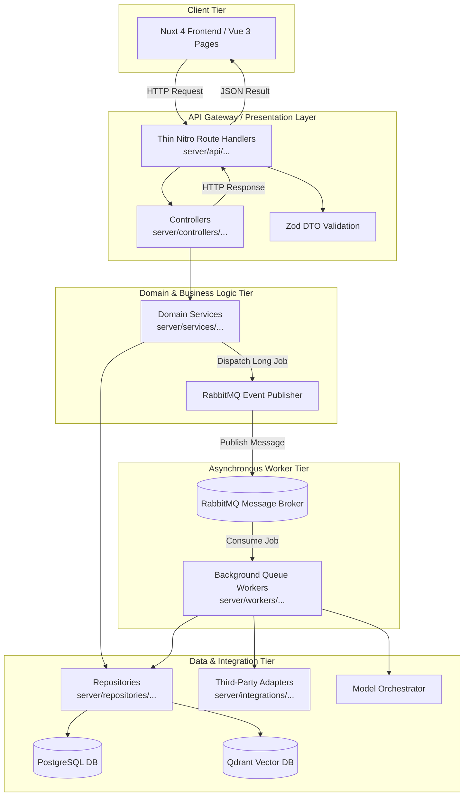
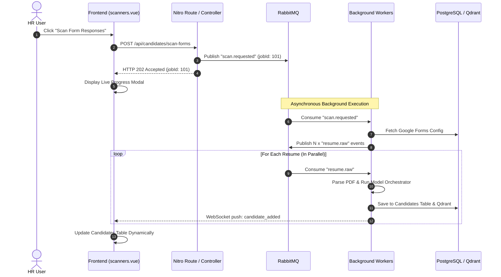

# Codebase Reformatting & Clean Architecture Blueprint

**Document Type:** Software Architecture Specification & Refactoring Plan  
**Target Architecture:** Layered Clean Architecture (Routes → Controllers → Services → Repositories) + Event-Driven Workers  
**Version:** 1.0.0  

---

## Table of Contents
1. [Architectural Assessment & Current Codebase Smells](#1-architectural-assessment--current-codebase-smells)
2. [Target Architecture & Design Principles](#2-target-architecture--design-principles)
   - [2.1 Architectural Flow Diagram](#21-architectural-flow-diagram)
   - [2.2 Layer Responsibilities & Strict Boundaries](#22-layer-responsibilities--strict-boundaries)
   - [2.3 Dependency Inversion & Single Responsibility](#23-dependency-inversion--single-responsibility)
3. [Target Project Directory Structure](#3-target-project-directory-structure)
4. [Layer-by-Layer Concrete Implementation Standards](#4-layer-by-layer-concrete-implementation-standards)
   - [4.1 Routes (Ultra-Thin Nitro Handlers)](#41-routes-ultra-thin-nitro-handlers)
   - [4.2 Controllers (HTTP & DTO Validation Layer)](#42-controllers-http--dto-validation-layer)
   - [4.3 Services (Pure Domain & Business Logic Layer)](#43-services-pure-domain--business-logic-layer)
   - [4.4 Repositories (Data Access Layer - SQL & Qdrant)](#44-repositories-data-access-layer---sql--qdrant)
   - [4.5 Integrations / Adapters (Third-Party Clients)](#45-integrations--adapters-third-party-clients)
   - [4.6 Event Bus & Background Workers (RabbitMQ)](#46-event-bus--background-workers-rabbitmq)
5. [Refactoring Case Study: Before vs. After](#5-refactoring-case-study-before-vs-after)
   - [5.1 Case Study 1: Candidates Listing & Filtering](#51-case-study-1-candidates-listing--filtering)
   - [5.2 Case Study 2: Long-Running Resume Processing & Matching](#52-case-study-2-long-running-resume-processing--matching)
6. [Step-by-Step Phased Migration Roadmap](#6-step-by-step-phased-migration-roadmap)

---

## 1. Architectural Assessment & Current Codebase Smells

An audit of the current `server/` directory reveals several architectural anti-patterns typical of early-stage MVPs:

### 1.1 Fatal Code Smells in Current Codebase
1. **"Fat" Route Handlers (No Layering):**
   - Files like `server/api/candidates/index.get.ts`, `server/api/jobs/index.get.ts`, and `server/api/google-forms/index.get.ts` write raw SQL queries (`pool.query(...)`), construct business filters, format HTTP responses, and parse query parameters all inside the same 80-line function.
2. **Synchronous Long-Running Operations Blocking HTTP Gateway:**
   - `server/api/candidates/scan-mail.post.ts` and `scan-forms.post.ts` fetch remote emails/drive attachments, parse PDFs, run vector embeddings, query Qdrant, invoke Ollama, upload to ImageKit, and write to PostgreSQL sequentially inside a single HTTP POST request.
   - If 15 resumes are scanned, this request takes 45–90 seconds, causing browser timeouts (504 Gateway Timeout) and memory saturation.
3. **Lack of Repository Layer:**
   - Raw SQL strings are scattered across 14 different files without centralized schema validation, parameter binding consistency, or type safety.
4. **Coupled Third-Party Integrations:**
   - WhatsApp, Gmail, Google Forms, Google Calendar, ImageKit, Qdrant, and Ollama are imported directly into route handlers or unstructured utility files in `server/utils/`.
5. **Zero Testability:**
   - Because business logic is glued to Nitro's `H3Event` context and database pools, writing unit tests is virtually impossible without booting the entire Nuxt application and mocking the database.

---

## 2. Target Architecture & Design Principles

We transition the application to a **Layered Clean Architecture** combined with an **Asynchronous Event-Driven Pipeline**.

### 2.1 Architectural Flow Diagram



### 2.2 Layer Responsibilities & Strict Boundaries

| Layer | Directory | Allowed Dependencies | Prohibited Actions | Responsibility |
|---|---|---|---|---|
| **Route Handler** | `server/api/` | Controllers, Zod Schemas | **NO** SQL, **NO** business logic, **NO** external API calls | Ultra-thin entry points. Routes request to Controller, handles HTTP return. |
| **Controller** | `server/controllers/` | Services, DTO Validators | **NO** SQL, **NO** direct DB access | Extracts parameters, validates body with Zod, sets HTTP status codes and headers. |
| **Service** | `server/services/` | Repositories, Integrations, Event Bus | **NO** HTTP request/response objects (`H3Event`, `res`, `req`) | Pure business logic, workflow orchestration, authorization rules, event dispatching. |
| **Repository** | `server/repositories/` | Database Pool (`pg`), Qdrant Client | **NO** business logic, **NO** HTTP context | Executes SQL queries, handles data mapping to TypeScript models. |
| **Integrations** | `server/integrations/` | Vendor SDKs (Groq, Google, ImageKit) | **NO** application domain logic | Wraps third-party APIs behind standardized interfaces. |
| **Workers** | `server/workers/` | Services, Repositories, Integrations | **NO** HTTP context | Background consumer processes executing jobs offloaded to RabbitMQ. |

---

## 3. Target Project Directory Structure

```
HR_Onboarding_Nuxt/
├── app/                                 # Nuxt Frontend Application
│   ├── components/
│   ├── pages/
│   │   ├── index.vue                   # Job Listings & JD Management
│   │   ├── candidates.vue              # Candidate Pipeline
│   │   ├── scanners.vue                # Scanner Controls & Active Forms
│   │   ├── interviews.vue              # Calendar & Interviews
│   │   └── settings/
│   │       ├── ai-models.vue           # BYOK & Model Orchestration Settings
│   │       └── playground.vue          # Prompt & Tuning Playground
│   └── types/
│
├── server/                              # Nitro Backend Server
│   ├── api/                             # ULTRA-THIN ROUTES ONLY (< 15 lines each)
│   │   ├── auth/
│   │   ├── candidates/
│   │   │   ├── index.get.ts            # Delegates to CandidateController.list
│   │   │   ├── [id].get.ts             # Delegates to CandidateController.getById
│   │   │   ├── scan.post.ts            # Dispatches scan job to RabbitMQ
│   │   │   └── selected/
│   │   ├── jobs/
│   │   ├── google-forms/
│   │   ├── interviews/
│   │   └── settings/
│   │       └── models.ts               # BYOK model management endpoints
│   │
│   ├── controllers/                     # HTTP CONTROLLER LAYER
│   │   ├── CandidateController.ts
│   │   ├── JobController.ts
│   │   ├── GoogleFormController.ts
│   │   ├── InterviewController.ts
│   │   └── ModelConfigController.ts
│   │
│   ├── services/                        # DOMAIN BUSINESS LOGIC
│   │   ├── CandidateService.ts          # Candidate lifecycle, scoring rules
│   │   ├── JobService.ts                # Job creation, criteria weight syncing
│   │   ├── ScannerService.ts            # Triggering & status tracking of ingestion
│   │   ├── InterviewService.ts          # Interview scheduling & slot booking
│   │   ├── SubscriptionService.ts       # Pro tier check (mockable for now)
│   │   │
│   │   ├── ai/                          # MODEL ORCHESTRATION SUBSYSTEM
│   │   │   ├── types.ts                 # ILLMProvider interface
│   │   │   ├── LLMFactory.ts            # Provider factory (Ollama, Groq, Gemini)
│   │   │   ├── providers/
│   │   │   │   ├── GroqProvider.ts
│   │   │   │   ├── OllamaProvider.ts
│   │   │   │   ├── GeminiProvider.ts
│   │   │   │   └── CustomLocalProvider.ts
│   │   │   └── playground/
│   │   │       └── BenchmarkRunner.ts   # Hyperparameter tuning runner
│   │   │
│   │   └── embeddings/                  # VECTOR EMBEDDINGS SUBSYSTEM
│   │       ├── types.ts                 # IEmbeddingProvider
│   │       ├── EmbeddingFactory.ts
│   │       └── providers/
│   │           ├── XenovaProvider.ts
│   │           └── OpenAIEmbeddingProvider.ts
│   │
│   ├── repositories/                    # DATA ACCESS LAYER (PostgreSQL & Qdrant)
│   │   ├── CandidateRepository.ts       # Raw SQL queries for candidates table
│   │   ├── JobRepository.ts             # Raw SQL queries for job_roles table
│   │   ├── GoogleFormRepository.ts      # Raw SQL queries for google_forms table
│   │   ├── InterviewRepository.ts       # Raw SQL queries for interview_schedules
│   │   ├── ScanStatusRepository.ts      # Raw SQL queries for scan_timestamps
│   │   ├── ModelConfigRepository.ts     # Workspace model settings & API keys
│   │   └── VectorRepository.ts          # Qdrant client vector operations
│   │
│   ├── integrations/                    # EXTERNAL ADAPTERS (Isolated third-parties)
│   │   ├── google/
│   │   │   ├── GmailClient.ts
│   │   │   ├── GoogleFormsClient.ts
│   │   │   └── GoogleCalendarClient.ts
│   │   ├── whatsapp/
│   │   │   └── WhatsAppClient.ts
│   │   ├── imagekit/
│   │   │   └── ImageKitClient.ts
│   │   └── rabbitmq/
│   │       ├── ConnectionManager.ts
│   │       └── EventPublisher.ts
│   │
│   ├── workers/                         # BACKGROUND QUEUE CONSUMERS (RabbitMQ)
│   │   ├── ResumeParseWorker.ts         # Consumes raw PDFs, runs pdf-parse
│   │   ├── ResumeMatchWorker.ts         # Consumes parsed resumes, runs AI & vector match
│   │   ├── CalendarSyncWorker.ts        # Scrapes Google Calendar events & runs agent
│   │   └── MailSyncWorker.ts            # Scrapes Gmail inbox & downloads attachments
│   │
│   ├── dto/                             # REQUEST/RESPONSE VALIDATION (Zod Schemas)
│   │   ├── CandidateDTO.ts
│   │   ├── JobDTO.ts
│   │   └── ModelConfigDTO.ts
│   │
│   ├── utils/                           # CROSS-CUTTING PURE UTILITIES
│   │   ├── crypto.ts                    # AES-256 encryption for API keys
│   │   ├── logger.ts                    # Structured Pino/Winston logging
│   │   └── response.ts                  # Standard API envelope: { success, data, error }
│   │
│   └── plugins/                         # NITRO STARTUP PLUGINS
│       ├── database.ts                  # Initializes PostgreSQL pool & runs migrations
│       ├── qdrant.ts                    # Verifies vector collections exist
│       └── rabbitmq.ts                  # Boots AMQP connections and queue consumers
```

---

## 4. Layer-by-Layer Concrete Implementation Standards

### 4.1 Routes (Ultra-Thin Nitro Handlers)
Every route in `server/api/` should be under 15 lines of code. It does not contain `if-else` business checks or SQL queries.

```typescript
// server/api/candidates/index.get.ts
import { CandidateController } from '~~/server/controllers/CandidateController'

export default defineEventHandler(async (event) => {
  return await CandidateController.listCandidates(event)
})
```

### 4.2 Controllers (HTTP & DTO Validation Layer)
The controller validates inputs, calls the service, and returns a standard response envelope.

```typescript
// server/controllers/CandidateController.ts
import type { H3Event } from 'h3'
import { CandidateService } from '~~/server/services/CandidateService'
import { FilterCandidatesSchema } from '~~/server/dto/CandidateDTO'
import { successResponse, errorResponse } from '~~/server/utils/response'

export class CandidateController {
  public static async listCandidates(event: H3Event) {
    try {
      const query = getQuery(event)
      const validatedQuery = FilterCandidatesSchema.parse(query)
      
      const result = await CandidateService.getCandidates(validatedQuery)
      return successResponse(result)
    } catch (err: any) {
      return errorResponse(event, err.message, 400)
    }
  }

  public static async triggerScan(event: H3Event) {
    try {
      const body = await readBody(event)
      const jobId = await CandidateService.enqueueScanJob(body)
      return successResponse({ jobId, message: 'Scan job enqueued successfully' }, 202)
    } catch (err: any) {
      return errorResponse(event, err.message, 500)
    }
  }
}
```

### 4.3 Services (Pure Domain & Business Logic Layer)
The service layer contains the application's core rules and is completely decoupled from HTTP:

```typescript
// server/services/CandidateService.ts
import { CandidateRepository } from '~~/server/repositories/CandidateRepository'
import { EventPublisher } from '~~/server/integrations/rabbitmq/EventPublisher'
import type { CandidateFilterDTO } from '~~/server/dto/CandidateDTO'

export class CandidateService {
  public static async getCandidates(filters: CandidateFilterDTO) {
    return await CandidateRepository.findAll(filters)
  }

  public static async enqueueScanJob(params: { sources: string[]; formIds?: string[] }): Promise<string> {
    const scanJobId = crypto.randomUUID()
    
    // Non-blocking: publish to RabbitMQ event bus
    await EventPublisher.publish('hr.events.direct', 'scan.requested', {
      jobId: scanJobId,
      sources: params.sources,
      formIds: params.formIds,
      requestedAt: new Date().toISOString()
    })

    return scanJobId
  }
}
```

### 4.4 Repositories (Data Access Layer - SQL & Qdrant)
All raw SQL queries reside exclusively in repositories:

```typescript
// server/repositories/CandidateRepository.ts
import { getDbPool } from '~~/server/plugins/database'
import type { CandidateFilterDTO, CandidateRecord } from '~~/server/dto/CandidateDTO'

export class CandidateRepository {
  public static async findAll(filters: CandidateFilterDTO): Promise<CandidateRecord[]> {
    const pool = getDbPool()
    const conditions: string[] = []
    const values: any[] = []
    let idx = 1

    if (filters.role && filters.role !== 'All') {
      conditions.push(`role_applied = $${idx++}`)
      values.push(filters.role)
    }

    if (filters.status && filters.status !== 'all') {
      conditions.push(`status = $${idx++}`)
      values.push(filters.status)
    }

    const whereClause = conditions.length > 0 ? `WHERE ${conditions.join(' AND ')}` : ''
    const query = `
      SELECT id, name, email, phone, role_applied, score, experience_level, 
             status, resume_url, applied_through, current_location, current_ctc, date_applied 
      FROM candidates 
      ${whereClause} 
      ORDER BY id DESC
    `

    const result = await pool.query(query, values)
    return result.rows
  }

  public static async upsert(candidate: Partial<CandidateRecord>): Promise<number> {
    const pool = getDbPool()
    const query = `
      INSERT INTO candidates (name, email, phone, role_applied, resume_content, score, experience_level, status, resume_url, applied_through, current_location, current_ctc)
      VALUES ($1, $2, $3, $4, $5, $6, $7, $8, $9, $10, $11, $12)
      ON CONFLICT (email, role_applied) 
      DO UPDATE SET score = $6, resume_url = $9, status = $8, updated_at = NOW()
      RETURNING id
    `
    const res = await pool.query(query, [
      candidate.name, candidate.email, candidate.phone, candidate.role_applied,
      candidate.resume_content, candidate.score, candidate.experience_level,
      candidate.status, candidate.resume_url, candidate.applied_through,
      candidate.current_location, candidate.current_ctc
    ])
    return res.rows[0].id
  }
}
```

---

## 5. Refactoring Case Study: Before vs. After

### 5.1 Case Study 1: Candidates Listing & Filtering

#### Before (Anti-pattern in `server/api/candidates/index.get.ts`):
```typescript
// 85 lines of mixed concerns:
export default defineEventHandler(async (event) => {
  const pool = getPool() // directly grabbing db
  const query = getQuery(event)
  let sql = 'SELECT * FROM candidates WHERE 1=1' // manual string concatenation
  if (query.role) sql += ` AND role_applied = '${query.role}'` // SQL injection risk!
  const res = await pool.query(sql)
  return res.rows // untyped payload returned directly
})
```

#### After (Clean Layered Pattern):
- **Route:** `server/api/candidates/index.get.ts` (3 lines, calls Controller).
- **Controller:** `CandidateController.listCandidates` validates query params with Zod, sets headers.
- **Service:** `CandidateService.getCandidates` applies business filters and tenancy scope.
- **Repository:** `CandidateRepository.findAll` executes parameterized, secure SQL query.

---

### 5.2 Case Study 2: Long-Running Resume Processing & Matching

#### Before:
1. User clicks "Scan Form Responses" or "Scan Email".
2. Browser keeps an HTTP socket open for up to 90 seconds.
3. Server executes:
   - IMAP fetch / Google Drive download
   - `pdf-parse`
   - Regex information extraction
   - Qdrant similarity search
   - Ollama LLM execution
   - ImageKit base64 image upload
   - PostgreSQL insert
4. If network glitches or Ollama hangs on resume #12, the entire batch fails and the client gets a 500/504 error.

#### After (RabbitMQ Asynchronous Pipeline):
1. User clicks "Scan".
2. Route handler immediately publishes `scan.requested` message to RabbitMQ and returns `HTTP 202 Accepted` with a `jobId` in **under 50ms**.
3. UI displays an active progress card with real-time status.
4. `ScannerWorker` pulls the job, downloads attachments, and publishes individual `resume.raw` messages for each PDF found.
5. Multiple concurrent `ResumeMatchWorker` instances consume resumes in parallel:
   - Processes PDF through `resumeParser`
   - Matches candidate against active JDs using `VectorRepository` and `LLMFactory`
   - Saves record via `CandidateRepository`
   - Emits a WebSocket/SSE event `candidate.processed` to update the frontend table in real-time.



---

## 6. Step-by-Step Phased Migration Roadmap

To prevent downtime or breaking the working application, refactoring must proceed in 4 surgical phases:

### Phase 1: Repository Extraction (Safe & Non-Breaking)
1. Create `server/repositories/`:
   - `CandidateRepository.ts`
   - `JobRepository.ts`
   - `GoogleFormRepository.ts`
   - `InterviewRepository.ts`
2. Migrate raw SQL queries out of route handlers into these repositories.
3. Keep route signatures unchanged so existing frontend pages continue working seamlessly.

### Phase 2: Service & Controller Layering
1. Create `server/services/` and `server/controllers/`.
2. Move business decisions, criteria weight calculations, and candidate status updates from routes into services.
3. Shrink route handlers in `server/api/` down to 1-line delegates.

### Phase 3: Integration & Model Orchestrator Decoupling
1. Move external client logic to `server/integrations/` (Gmail, WhatsApp, ImageKit).
2. Wire in the `server/services/ai/` module (LLD specified in `model_orchestration.md`) replacing old `server/utils/ai.ts`.

### Phase 4: RabbitMQ Event Bus & Worker Pipeline
1. Add `rabbitmq:3-management-alpine` container to `docker-compose.yml`.
2. Create `server/integrations/rabbitmq/ConnectionManager.ts` and `EventPublisher.ts`.
3. Create worker consumers in `server/workers/` for long-running scanner tasks.
4. Connect frontend to a Server-Sent Events (SSE) or WebSocket route for live scanning progress.
